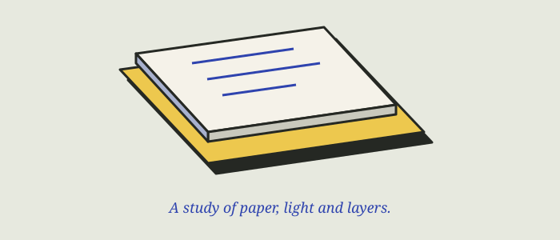

# 纸张与屏幕之间

当数字页面借用纸张的纹理、厚度和翻页的动作，它带来的不只是装饰，也可以是一种熟悉的阅读方式。

> 示例文档 · 用于测试设计笔记、相对图片、层级和表格，不代表 Lynn 的真实学习记录。

## 材质是一种提示

纸张的颗粒暗示触感，边缘的阴影暗示厚度。界面里这些细节不必完全模拟现实，只需要让“哪张纸在上面、什么可以拿起”变得容易理解。

同样的层次关系，也能通过轮廓、留白和色块来表达。让材质服务于内容，避免纹理压过文字。

## 把立体，压成几块颜色

三渲二风格常把连续的明暗压成几个色阶，再用清晰轮廓突出形状。这样物体仍然可以旋转，却保留插画般的平面感。

| 视觉元素 | 在界面中的作用 |
| --- | --- |
| 分段明暗 | 表达物体的朝向 |
| 清晰轮廓 | 将主体从背景中分离 |
| 硬边投影 | 强调纸张与工作台的距离 |
| 克制纹理 | 提供材质感，同时保持可读性 |

## 动画要回答一个问题

点击手记后，阅读页从卡片的位置展开。它回答的是：“刚才那篇手记去了哪里？”关闭时，内容收回，读者仍然停留在原来的书架位置。

### 让阅读稳定下来

- 进入动画可以有个性，但应很快结束。
- 正文保持稳定，避免持续晃动。
- 触屏不依赖悬停才能发现功能。
- 尊重系统的减少动态效果设置。

## 一个观察练习

随意打开身边的一本书。观察封面、书脊、纸边和投影，只用四种颜色画下来。再思考：如果这本书成为一个界面，它最重要的动作是什么？

[返回开始页](../从这里开始.md)
